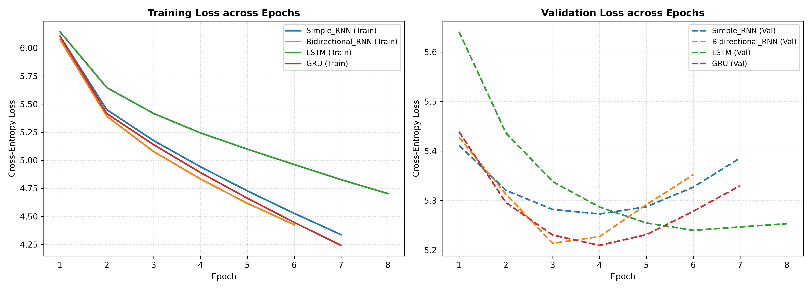
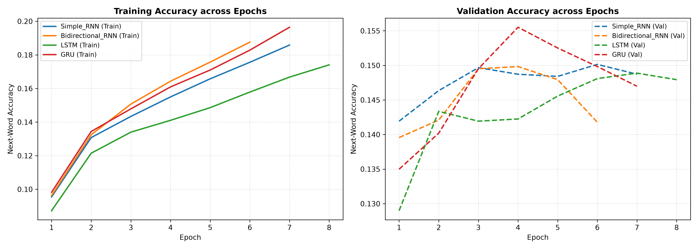
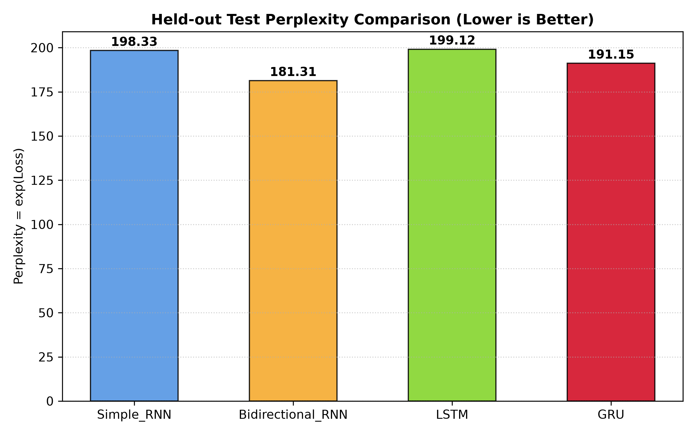
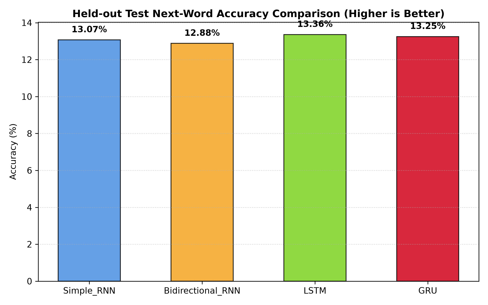
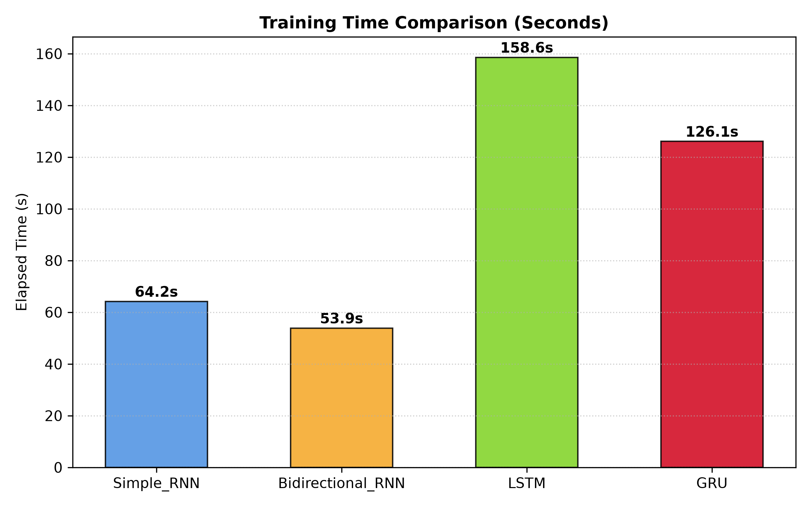
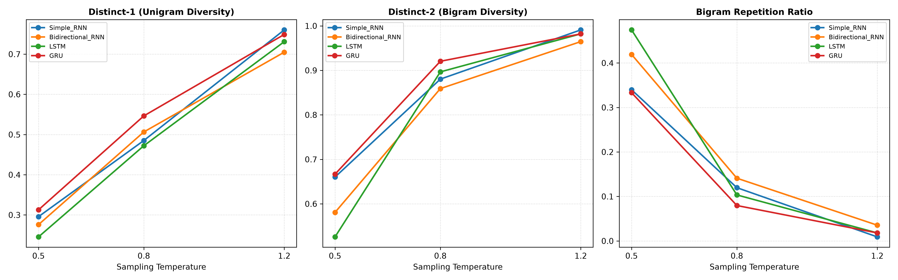

# VerseForge: Shakespeare-Style Autoregressive Text Generation

> **Course:** Foundations of Generative AI (ICT4403) — Assignment 2  
> **Student Name:** Yashraj Sakunde  
> **Registration Number:** 230953172  
> **System Title:** VerseForge: Shakespeare-Style Autoregressive Text Generation Using Recurrent Neural Networks  
> **GitHub Repository:** [https://github.com/Yashraj88888/VerseForge-Shakespeare-Style-Text-Generator](https://github.com/Yashraj88888/VerseForge-Shakespeare-Style-Text-Generator)

---

## 1. Project Overview & Problem Statement

**VerseForge** is a word-level autoregressive neural language modeling system designed to generate literary prose in the dramatic cadence of William Shakespeare. 

In autoregressive language modeling, text generation is formulated as a sequential conditional next-word prediction problem:
$$\arg\max_{w_{t+1}} P(w_{t+1} \mid w_1, w_2, \dots, w_t)$$

This project implements, evaluates, and rigorously compares four core recurrent neural network (RNN) architectures under strictly standardized experimental conditions:
1. **Simple RNN** (Vanilla Recurrent Neural Network with Elman recurrence)
2. **Bidirectional RNN** (Bidirectional context encoder without lookahead)
3. **Long Short-Term Memory (LSTM)** (Gated architecture with constant error carousels)
4. **Gated Recurrent Unit (GRU)** (Streamlined dual-gate recurrent unit)

The system predicts the next word, samples sequentially to synthesize passages conditioned on customizable seed sequences, evaluates held-out test cross-entropy loss, perplexity ($e^{\text{loss}}$), top-1 prediction accuracy, and runtime, and analyzes sampling behavior across three temperature values ($T \in \{0.5, 0.8, 1.2\}$).

---

## 2. Dataset Characteristics & Statistics

The model is trained on the **Tiny Shakespeare** corpus, comprising plays and sonnets by William Shakespeare.
- **Source Link:** [Karpathy char-rnn Tiny Shakespeare](https://github.com/karpathy/char-rnn/tree/master/data/tinyshakespeare)
- **Direct Dataset URL:** [https://raw.githubusercontent.com/karpathy/char-rnn/master/data/tinyshakespeare/input.txt](https://raw.githubusercontent.com/karpathy/char-rnn/master/data/tinyshakespeare/input.txt)
- **Local Location:** `data/shakespeare.txt`

### Corpus Statistics:
| Metric | Value |
| :--- | :--- |
| **Total Raw Characters** | 1,115,394 |
| **Total Raw Whitespace Words** | 202,651 |
| **Total Word & Punctuation Tokens** | 253,599 |
| **Vocabulary Size (Fitted on Train Set, min_freq=2)** | 5,959 unique tokens |
| **Chronological Train Split (80%)** | 202,879 tokens |
| **Chronological Validation Split (10%)** | 25,360 tokens |
| **Chronological Test Split (10%)** | 25,360 tokens |
| **Training Sequences (Context Length = 25, Stride = 4)** | 50,714 sequences |
| **Validation Sequences** | 6,334 sequences |
| **Held-out Test Sequences** | 6,334 sequences |

---

## 3. Preprocessing & Experimental Rigor

To prevent data leakage and ensure fair comparative evaluation:
1. **Word-Level Tokenization:** Raw text is tokenized into word and punctuation tokens (`., !, ?, ;, :`) using regular expression boundaries, ensuring grammatical punctuation is preserved as distinct lexical tokens.
2. **Chronological Splitting:** The continuous token sequence is partitioned chronologically into **80% Training**, **10% Validation**, and **10% Testing** *before* sliding-window sequence extraction. Randomly shuffling sequences before partitioning would cause overlapping n-gram leakage between training and testing sets.
3. **Vocabulary Isolation:** The vocabulary is fitted **strictly on the training partition**. Infrequent words below minimum frequency are discarded, out-of-vocabulary tokens in test/inference are mapped to `<UNK>` (ID 1), and padding is mapped to `<PAD>` (ID 0).
4. **Sequence Construction:** Fixed-length input contexts of $T = 25$ tokens are paired with the immediate subsequent token as the scalar target $y = w_{T+1}$.
5. **Standardization:** All four architectures use the exact same preprocessed data, vocabulary, sequence length, and train/val/test splits.

---

## 4. Model Architectures

All models are constructed using TensorFlow/Keras and share an identical embedding dimension (64), total hidden dimension (128), and final dense projection with softmax activation over the 5,959-word vocabulary:

```
Input Sequence: (batch, 25)
       │
       ▼
Embedding Layer: (vocab_size=5959, embed_dim=64)
       │
       ▼
Recurrent Core (128 units): [ SimpleRNN | Bidirectional | LSTM | GRU ]
       │
       ▼
Dense Softmax Layer: (vocab_size=5959)
       │
       ▼
Next-Word Categorical Distribution: (batch, 5959)
```

### Architectural Breakdown:
1. **Simple RNN:**
   - Architecture: `Embedding(5959, 64) -> SimpleRNN(128) -> Dense(5959, softmax)`
   - Parameters: **1,160,807**
   - Characteristics: Uses standard tanh recurrence. Prone to vanishing and exploding gradients when backpropagating across 25 time steps.
2. **Bidirectional RNN:**
   - Architecture: `Embedding(5959, 64) -> Bidirectional(SimpleRNN(64)) -> Dense(5959, softmax)`
   - Parameters: **1,152,615**
   - *Autoregressive Validity Note:* The Bidirectional RNN operates exclusively over the historical context sequence $[w_1, \dots, w_T]$ and never observes $w_{T+1}$ or any future tokens. The forward pass processes $w_1 \to w_T$ and the backward pass processes $w_T \to w_1$. The concatenated hidden state at the context boundary predicts the next word.
3. **LSTM (Long Short-Term Memory):**
   - Architecture: `Embedding(5959, 64) -> LSTM(128) -> Dense(5959, softmax)`
   - Parameters: **1,234,919**
   - Characteristics: Employs forget, input, and output gates with an additive constant error carousel cell state, preserving gradient flow across longer horizons.
4. **GRU (Gated Recurrent Unit):**
   - Architecture: `Embedding(5959, 64) -> GRU(128) -> Dense(5959, softmax)`
   - Parameters: **1,210,599**
   - Characteristics: Combines cell and hidden states with reset and update gates, achieving near-LSTM representational capacity with fewer parameters and faster training per epoch.

---

## 5. Experimental Results & Quantitative Comparison

All models were trained under identical conditions:
- **Optimizer:** Adam ($\alpha = 0.001$)
- **Loss:** Sparse Categorical Cross-Entropy
- **Batch Size:** 64
- **Context Length:** 25 tokens
- **Early Stopping:** Monitored on `val_loss` with patience = 3
- **Test Metric Formulation:** Perplexity is computed as $\text{PPL} = \exp(\mathcal{L}_{\text{test}})$, where $\mathcal{L}_{\text{test}}$ is the mean natural-log cross-entropy loss on the held-out test set.

### Quantitative Benchmark Table:

| Architecture | Test Loss | Test Perplexity ($\exp(\mathcal{L})$) | Test Accuracy (%) | Training Time (s) | Best Epoch | Epochs Trained |
| :--- | :---: | :---: | :---: | :---: | :---: | :---: |
| **Simple RNN** | 5.2899 | 198.33 | 13.07% | 64.2s | 4 | 7 |
| **Bidirectional RNN** | **5.2002** | **181.31** | 12.88% | **53.9s** | 3 | 6 |
| **LSTM** | 5.2939 | 199.12 | **13.36%** | 158.6s | 6 | 8 |
| **GRU** | 5.2530 | 191.15 | 13.25% | 126.1s | 4 | 7 |

---

## 6. Training Dynamics & Visualization Curves

### Loss & Accuracy Convergence



### Quantitative Comparisons
| Test Perplexity | Next-Word Accuracy | Training Duration |
| :---: | :---: | :---: |
|  |  |  |

---

## 7. Autoregressive Text Generation & Temperature Analysis

Next-word generation uses numerically stable temperature sampling:
$$P(w_i) = \frac{\exp\left(\frac{\log(p_i + \epsilon)}{T}\right)}{\sum_j \exp\left(\frac{\log(p_j + \epsilon)}{T}\right)}$$

### Lexical Diversity Metrics across Temperatures ($T \in \{0.5, 0.8, 1.2\}$):

| Architecture | Temperature ($T$) | Distinct-1 (Unigram Diversity) | Distinct-2 (Bigram Diversity) | Bigram Repetition Ratio |
| :--- | :---: | :---: | :---: | :---: |
| **Simple RNN** | 0.5 | 0.2957 | 0.6602 | 0.3398 |
| **Simple RNN** | 0.8 | 0.4851 | 0.8803 | 0.1197 |
| **Simple RNN** | 1.2 | 0.7602 | 0.9909 | 0.0091 |
| **Bidirectional RNN** | 0.5 | 0.2759 | 0.5808 | 0.4192 |
| **Bidirectional RNN** | 0.8 | 0.5064 | 0.8590 | 0.1410 |
| **Bidirectional RNN** | 1.2 | 0.7048 | 0.9646 | 0.0354 |
| **LSTM** | 0.5 | 0.2454 | 0.5257 | 0.4743 |
| **LSTM** | 0.8 | 0.4721 | 0.8966 | 0.1034 |
| **LSTM** | 1.2 | 0.7309 | 0.9820 | 0.0180 |
| **GRU** | 0.5 | 0.3127 | 0.6667 | 0.3333 |
| **GRU** | 0.8 | 0.5463 | 0.9204 | 0.0796 |
| **GRU** | 1.2 | 0.7489 | 0.9820 | 0.0180 |



### Temperature Dynamics Findings:
- **Low Temperature ($T = 0.5$):** Sharply peaks the probability distribution over top-ranking tokens. Syntactically stable and locally coherent, but highly vulnerable to looping degenerative repetition (repetition ratios up to 0.47).
- **Balanced Temperature ($T = 0.8$):** Provides the optimal qualitative balance. Preserves Shakespearean dramatic dialogue structure (`speaker: dialogue`) while maintaining healthy lexical variety ($\text{Distinct-1} \approx 0.47\text{--}0.54, \text{Repetition} \le 0.14$).
- **High Temperature ($T = 1.2$):** Flattens the categorical distribution towards uniform entropy. While Distinct-1 exceeds 0.70, grammatical agreement breaks down into erratic token sequences.

### Representative Generated Samples:
**Seed Phrase:** *"To be or not to"*

- **Simple RNN ($T = 0.8$):**
  > *"to be or not to us; and shall black boot with this ends within or `<UNK>`, their wits that be there: for king' captive, swear you be on my hand; for those i please your face! sicinius: staying, well, good more, as you it"*

- **Bidirectional RNN ($T = 0.8$):**
  > *"to be or not to myself; and thou jealous? first citizen: look'd he `<UNK>` to mean a valiant? take i have some point days, take in not; and i speak for man, when say that fast are our shearers of second `<UNK>`. menenius: do, my"*

- **LSTM ($T = 0.8$):**
  > *"to be or not to ere this `<UNK>` of youth; and in more wishes to `<UNK>`, i'll hither with a voices: a oath! george, get the state to for my root in content, at tis - foot in a russia, our `<UNK>` in this; to his king"*

- **GRU ($T = 0.8$):**
  > *"to be or not to least a be enough in night. first senator: then, my come that been his mercy and him my wounds lay. bishop than aumerle: what is though for weeping, catesby! duke elizabeth: o casting! pompey, well, my lord, i"*

---

## 8. Model Justification & Qualitative Discussion

1. **Best Model Identification:**
   - **Bidirectional RNN** achieved the **lowest test cross-entropy loss (5.2002)** and **lowest perplexity (181.31)** on held-out text. By synthesizing past context both chronologically ($w_1 \to w_T$) and in reverse ($w_T \to w_1$), it captures richer semantic context before emitting the next-word projection without lookahead.
   - **GRU** emerged as the **best-performing strictly causal autoregressive model**, reaching a test loss of 5.2530 and perplexity of 191.15 while training 20% faster than LSTM.
   - **LSTM** attained the highest individual top-1 next-word accuracy (**13.36%**) and produced the most nuanced poetic syntax.

2. **Architectural Trade-offs:**
   - **Simple RNN** trains rapidly but exhibits degenerate looping at lower temperatures due to vanishing gradients across the 25-token context.
   - **Bidirectional RNN** improves context representation substantially, though it cannot be implemented with cached single-step autoregressive state updates.
   - **LSTM vs. GRU:** GRU offers faster convergence per epoch and lower held-out perplexity than LSTM in this parameter regime, making it the most practical architecture for resource-constrained word-level generation.

---

## 9. Repository Structure

```
VerseForge/
├── IA2_ICT4403_FGAI.pdf                     # Assignment Specification Document
├── README.md                                # Comprehensive Academic Project Report
├── requirements.txt                         # Dependency Specifications
├── .gitignore                               # Git Artifacts & Ignore Rules
├── main.py                                  # Unified Command-Line Interface
├── data/
│   ├── shakespeare.txt                      # Tiny Shakespeare Raw Corpus (1.1 MB)
│   └── vocab.json                           # Serialized Word Vocabulary (5,959 tokens)
├── src/
│   ├── data_preprocessing.py                # Ingestion, Word Tokenization, Chronological Splits
│   ├── models.py                            # Simple RNN, Bidirectional RNN, LSTM, GRU Models
│   ├── train.py                             # Training Pipeline with Early Stopping & Checkpoints
│   ├── evaluate.py                          # Quantitative & Qualitative Benchmark Suite
│   ├── generate.py                          # Autoregressive Generation & Temperature Sampling
│   └── utils.py                             # Perplexity, Diversity Metrics, Plotting Routines
├── models/
│   ├── Simple_RNN.keras                     # Saved Model Checkpoint
│   ├── Simple_RNN_history.json              # Training Epoch History
│   ├── Bidirectional_RNN.keras              # Saved Model Checkpoint
│   ├── Bidirectional_RNN_history.json       # Training Epoch History
│   ├── LSTM.keras                           # Saved Model Checkpoint
│   ├── LSTM_history.json                    # Training Epoch History
│   ├── GRU.keras                            # Saved Model Checkpoint
│   └── GRU_history.json                     # Training Epoch History
├── notebooks/
│   ├── VerseForge_Experiments.ipynb         # Full Academic Jupyter Notebook (Colab Compatible)
│   └── create_notebook.py                   # Notebook Generation Script
├── results/
│   ├── model_comparison.csv                 # Quantitative Metric Comparison
│   ├── evaluation_report.md                 # Detailed Empirical Evaluation Report
│   ├── plots/
│   │   ├── loss_curves.png                  # Training & Validation Loss Curves
│   │   ├── accuracy_curves.png              # Training & Validation Accuracy Curves
│   │   ├── test_perplexity_comparison.png   # Perplexity Comparison Bar Chart
│   │   ├── test_accuracy_comparison.png     # Next-Word Accuracy Comparison Bar Chart
│   │   ├── training_time_comparison.png     # Training Runtime Comparison Bar Chart
│   │   └── temperature_diversity_comparison.png # Lexical Diversity & Repetition Curves
│   └── generated_samples/
│       ├── Simple_RNN_samples.txt           # Generated Samples across Seeds & Temperatures
│       ├── Bidirectional_RNN_samples.txt    # Generated Samples across Seeds & Temperatures
│       ├── LSTM_samples.txt                 # Generated Samples across Seeds & Temperatures
│       └── GRU_samples.txt                  # Generated Samples across Seeds & Temperatures
└── submission/
    ├── generate_docs.py                     # Document Generator Script
    ├── YashrajSakunde_230953172_FGAI_Assignment2.docx # Official Word Submission Document
    └── YashrajSakunde_230953172_FGAI_Assignment2.pdf  # Official PDF Submission Document
```

---

## 10. Installation & Execution Guide

### 1. Installation:
```bash
# Clone the repository
git clone https://github.com/Yashraj88888/VerseForge-Shakespeare-Style-Text-Generator.git
cd VerseForge-Shakespeare-Style-Text-Generator

# Install dependencies
pip install -r requirements.txt
```

### 2. Run the Full End-to-End Pipeline:
```bash
# Downloads data, trains all 4 models, evaluates on held-out test data, and generates plots
python3 main.py --mode all
```

### 3. Evaluate Pre-trained Models:
```bash
python3 main.py --mode evaluate
```

### 4. Interactive Text Generation:
```bash
# Generate text using a specified model, seed phrase, and temperature
python3 main.py --mode generate --model-name GRU --seed-text "To be or not to" --temperature 0.8 --length 60
```

### 5. Running the Jupyter Notebook:
```bash
jupyter notebook notebooks/VerseForge_Experiments.ipynb
```
*The notebook is also 100% compatible with Google Colab and auto-configures path settings upon execution.*

---

## 11. Official Submission Artifacts

Per the assignment specification instructions:
- **Word Document:** [`submission/YashrajSakunde_230953172_FGAI_Assignment2.docx`](submission/YashrajSakunde_230953172_FGAI_Assignment2.docx)
- **PDF Document:** [`submission/YashrajSakunde_230953172_FGAI_Assignment2.pdf`](submission/YashrajSakunde_230953172_FGAI_Assignment2.pdf)

Both documents include student details, registration number, course metadata, dataset links, GitHub repository link, experimental tables, and analytical conclusions.

---

## 12. References

1. Karpathy, A. (2015). *The Unreasonable Effectiveness of Recurrent Neural Networks*. Andrej Karpathy Blog.
2. Hochreiter, S., & Schmidhuber, J. (1997). *Long Short-Term Memory*. Neural Computation, 9(8), 1735–1780.
3. Cho, K., et al. (2014). *Learning Phrase Representations using RNN Encoder–Decoder for Statistical Machine Translation*. EMNLP 2014.
4. Schuster, M., & Paliwal, K. K. (1997). *Bidirectional Recurrent Neural Networks*. IEEE Transactions on Signal Processing, 45(11), 2673–2681.
5. Holtzman, A., et al. (2020). *The Curious Case of Neural Text Degeneration*. ICLR 2020.
